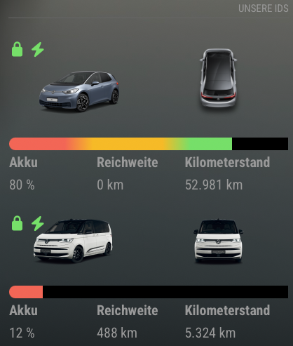

# MMM-weconnectid_MQTT

A [MagicMirror²](https://magicmirror.builders/) module that displays live vehicle data from **Volkswagen Group** cars (VW, Audi, SEAT, Škoda, Cupra) using the **EU Data Act portal** as data source.

Supports **pure electric vehicles** (ID.3, ID.4, ID.5, ID.7, e-Golf, …) and **plug-in hybrids** (Multivan, Golf GTE, …).

> **Why this module?**  
> The classic WeConnect API used by many mirror modules no longer works reliably.  
> The EU Data Act portal is the official way to access your own vehicle data.  
> Data is delivered as ZIP files roughly every 15 minutes and is strictly read-only.

---

## Screenshot



---

## How it works

```
VW EU Data Act portal  (every 15 min)
        │
   vw_mqtt.py          (background service)
        │
   Mosquitto MQTT      (localhost:1883)
        │
   api.py              (called by node_helper.js)
        │
MMM-weconnectid_MQTT   (displayed on MagicMirror)
```

---

## Prerequisites

| Software | Install |
|---|---|
| MagicMirror² | https://magicmirror.builders/ |
| Python 3.9+ | replace `python3` with `python3.9` etc. if needed|
| Mosquitto MQTT broker | `sudo apt install mosquitto mosquitto-clients` |
| paho-mqtt | `sudo pip3 install paho-mqtt --break-system-packages` |
| CarConnectivity connector | see below |

---

## Installation

### Step 1 – Activate the VW EU Data Act portal

1. Open https://eu-data-act.drivesomethinggreater.com in a browser.
2. Log in with your **Volkswagen ID** (same credentials as the VW app).
3. Go to **Data clusters → Vehicle overview → Get customised data**.
4. Select **continuous data, 15-minute interval**.
5. Wait 15–30 minutes until the first ZIP file appears.

> ⚠️ This step must be done **manually** for each VW account. It is a one-time setup.

### Step 2 – Install the Python connector

> Use connector **version 0.3.5 or newer**. Older versions fail to log in with HTTP 406.

First check which Python version you will use:
```bash
python3 --version
# or if you plan to use python3.9:
python3.9 --version
```

Install the connector for **that exact Python version** (replace `python3` with `python3.9` etc. if needed):

```bash
sudo python3 -m pip install --no-deps --break-system-packages carconnectivity
sudo python3 -m pip install --no-deps --upgrade --force-reinstall --break-system-packages \
    git+https://github.com/mikrohard/CarConnectivity-connector-vw-eu-data-act.git
sudo python3 -m pip install --break-system-packages paho-mqtt
```

> ⚠️ The Python version used here **must match** the `python` setting in `config.js`.  
> Example: if you set `python: "python3.9"` in config.js, install with `sudo python3.9 -m pip install ...`

Verify:
```bash
python3 -m pip show carconnectivity-connector-vw-eu-data-act | grep Version
python3 -c "from carconnectivity_connectors.vw_eu_data_act.client import EudaApiClient; print('OK')"
```

### Step 3 – Install Mosquitto

```bash
sudo apt install mosquitto mosquitto-clients -y
sudo systemctl enable mosquitto
sudo systemctl start mosquitto
```

### Step 4 – Clone this module

```bash
cd ~/MagicMirror/modules
git clone https://github.com/ChrisF1976/MMM-weconnectid_MQTT.git
```

### Step 5 – Configure vw_mqtt.py

Edit `vw_mqtt.py` and fill in your vehicles in the `CARS` list:

```python
CARS = [
    {
        "email":      "your@email.com",      # VW account e-mail
        "password":   "yourpassword",         # VW account password
        "vin":        "WVWZZZE1ZNP000000",    # Vehicle VIN (see registration document)
        "identifier": "",                     # Leave empty – fetched automatically
        "topic":      "vwdata/mycar",         # MQTT topic – must match config.js
        # "brand":    "SKODA",                # Only for non-VW brands, see below
    },
]
```

The data format (electric / hybrid / e-Golf …) is **detected automatically**. The old `"type"` setting is no longer needed and is ignored.

**Brand (optional):** the default is `VOLKSWAGEN_PASSENGER_CARS`. For other brands, set `"brand"` to one of:
`SKODA`, `AUDI`, `SEAT`, `CUPRA`, `BENTLEY`, `VOLKSWAGEN_COMMERCIAL_VEHICLES`.
A wrong brand typically leads to an HTTP 404 error from the portal.

> **Finding your VIN:** It is printed on the vehicle registration document (field E) and on the dashboard visible through the windscreen.

> **Never publish this file with your real credentials.** If you fork the repository, keep your passwords only in your local copy.

### Step 6 – Test vw_mqtt.py

Use the same Python as in Step 2 (`python3`, `python3.9`, …):

```bash
python3 ~/MagicMirror/modules/MMM-weconnectid_MQTT/vw_mqtt.py
```

You should see output like:
```
INFO [WVWZZZE1ZNP000000] Downloading 20260808132701_WVWZZZE1ZNP000000.zip...
INFO   vwdata/mycar/data_format = nested
INFO   vwdata/mycar/soc = 80
INFO   vwdata/mycar/odometer = 50313
...
```

The `data_format` line shows what was detected: `nested` (ID models) or `flat` (e-Golf, hybrids such as the Multivan). If you see the warning `No known fields found in this dataset`, see Troubleshooting.

Stop the test with `Ctrl+C`, then verify the MQTT data:
```bash
mosquitto_sub -h localhost -t "vwdata/#" -v
```

### Step 7 – Install as a systemd service (autostart)

This makes `vw_mqtt.py` start automatically every time the Raspberry Pi boots.

**7a – Find out your username and Python path:**
```bash
whoami
which python3
```
Example output: `chris` and `/usr/bin/python3`

**7b – Copy the service file:**
```bash
sudo cp ~/MagicMirror/modules/MMM-weconnectid_MQTT/vw_mqtt.service \
        /etc/systemd/system/vw_mqtt.service
```

**7c – Edit the service file** and replace the three placeholder values:
```bash
sudo nano /etc/systemd/system/vw_mqtt.service
```

Change these lines (use the values from step 7a). `ExecStart` must use the same Python that has `paho-mqtt` and the connector installed, for example `/usr/local/bin/python3.9`:
```ini
User=chris
WorkingDirectory=/home/chris/MagicMirror/modules/MMM-weconnectid_MQTT
ExecStart=/usr/bin/python3 /home/chris/MagicMirror/modules/MMM-weconnectid_MQTT/vw_mqtt.py
```

Save with `Ctrl+O`, `Enter`, `Ctrl+X`.

**7d – Enable and start the service:**
```bash
sudo systemctl daemon-reload
sudo systemctl enable vw_mqtt
sudo systemctl start vw_mqtt
sudo systemctl status vw_mqtt
```

You should see `active (running)` in the status output.

**7e – Check the live logs** to confirm data is being fetched:
```bash
sudo journalctl -u vw_mqtt -f
```

You should see lines like `vwdata/mycar/soc = 80`. Press `Ctrl+C` to exit.

### Step 8 – Add the module to config.js

```javascript
{
    module: 'MMM-weconnectid_MQTT',
    header: "My Car",
    position: "bottom_right",
    config: {
        username: "vwdata/mycar",       // MQTT topic – must match "topic" in vw_mqtt.py
        vin: "WVWZZZE1ZNP000000",       // for display only
        fields: '{"SOC":"remainingSoC","Updated":"timestamp","Mileage":"odometer","Charge time":"remainingTime","Target SOC":"targetSoC","Power":"chargePower","km/h":"chargekmph"}',
        fields_charging: ["Charge time", "Target SOC", "Power", "km/h"],
        number: 4,
        python: "python3",              // must be the same Python as in Step 2, e.g. "python3.9"
        maxHeight: "200px",
        maxWidth: "400px",
        remainingSOCyellow: 60,
        remainingSOCred: 25,
        barstyle: "strict",
        updateFrequency: 15 * 60 * 1000,
        timestamp: false,
    }
},
```

> **Multiple vehicles:** Add one module block per vehicle, each with a different `username` (= MQTT topic) and its own `vin`.

> **Hybrids:** Add `"Tank":"fuelLevel"` or `"Range":"gasolineRange"` to `fields` if you want the fuel level or range shown.

---

## Configuration options

| Option | Description | Default |
|---|---|---|
| `username` | MQTT topic prefix (e.g. `vwdata/mycar`) | `vwdata/mycar` |
| `vin` | Vehicle VIN – for display purposes only | `""` |
| `fields` | JSON string defining which fields to display | see above |
| `fields_charging` | Fields shown only when charging | `["LOADING TIME","TARGET SOC","LOADING POWER","KMPH"]` |
| `number` | Number of columns in the data table | `4` |
| `python` | Python executable (`python3`, `python3.9`, …) | `python3` |
| `maxHeight` | Maximum height of the module | `300px` |
| `maxWidth` | Maximum width of the module | `800px` |
| `remainingSOCyellow` | SoC threshold for yellow warning | `70` |
| `remainingSOCred` | SoC threshold for red warning | `20` |
| `barstyle` | Battery bar style: `fluent` or `strict` | `fluent` |
| `updateFrequency` | Update interval in milliseconds | `900000` (15 min) |
| `timestamp` | Always show data timestamp below module | `false` |

### Available field keys

| Key | Description |
|---|---|
| `remainingSoC` | Battery state of charge (%) |
| `remainingKm` | Remaining range (km) |
| `electricRange` | Electric range (km) – hybrid only |
| `gasolineRange` | Fuel range (km) – hybrid only |
| `odometer` | Total mileage (km) |
| `chargingState` | Charging status |
| `chargePower` | Charging power (kW) |
| `targetSoC` | Target charge level (%) |
| `remainingTime` | Remaining charge time (HH:MM) |
| `chargekmph` | Charge speed (km/h range added) |
| `fuelLevel` | Fuel tank level (%) – hybrid only |
| `outdoorTemp` | Outdoor temperature (°C) |
| `timestamp` | Timestamp of last vehicle data |
| `position` | Last known position |

---

## Vehicle images

Place two PNG files in:
```
modules/MMM-weconnectid_MQTT/Pictures/<module-identifier>/
    car.png      – side view of your vehicle
    status.png   – charging/status overlay image
```

The `<module-identifier>` is printed in the MagicMirror developer console when the module starts.

---

## Troubleshooting

**Module shows "Loading..."**  
→ Check if `vw_mqtt.py` is running: `sudo systemctl status vw_mqtt`  
→ Check MQTT data: `mosquitto_sub -h localhost -t "vwdata/#" -v`

**Login fails (HTTP 406, "consent", "marketing")**  
→ Update the connector to version 0.3.5 or newer (see Step 2).  
→ Log in once at https://eu-data-act.drivesomethinggreater.com in a browser and answer the consent / marketing question that is shown. Without this, the login by script can fail.  
→ Restart the service: `sudo systemctl restart vw_mqtt`

**HTTP 404 from the portal (e.g. Škoda Enyaq)**  
→ Set the correct `"brand"` for that car in `vw_mqtt.py` (see Step 5).

**"No known fields found" / 0 fields published**  
→ Make sure the continuous data request (Step 1) is active and at least one ZIP file exists in the portal.  
→ Open an issue with the field names from the log (without credentials).

**Data looks old (timestamp hours or days behind the VW app)**  
→ The module shows the capture time reported by the portal. For some cars the portal delivers measurements with a long delay, even though new ZIP files are created every ~15 minutes. This happens on the VW side and cannot be fixed by this module.  
→ Check the live log: `sudo journalctl -u vw_mqtt -n 40 --no-pager`

**HTTP 500 errors from the VW portal**  
→ The portal occasionally has outages. `vw_mqtt.py` retries automatically every 15 minutes.

**Wrong Python version / "No module named paho"**  
→ Use the same Python everywhere: in the service file (`ExecStart`), when installing `paho-mqtt` and the connector, and as `python` in `config.js`.

**Range values look swapped (hybrids)**  
→ For plug-in hybrids the portal reports the combustion range as "primary engine" and the electric range as "secondary engine". If your model behaves differently, swap the two entries in `FIELD_MAP_HYBRID` in `vw_mqtt.py` and open an issue.

---

## Based on

- Original module: [MMM-weconnectid](https://github.com/NikolasRupp/MMM-weconnectid) by NikolasRupp  
- EU Data Act connector: [CarConnectivity-connector-vw-eu-data-act](https://github.com/mikrohard/CarConnectivity-connector-vw-eu-data-act) by mikrohard

---

## License

MIT
